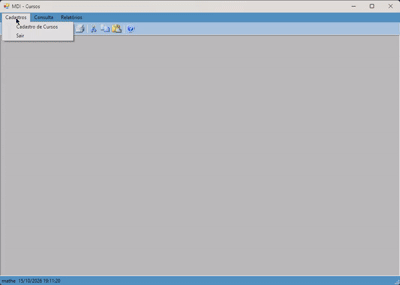
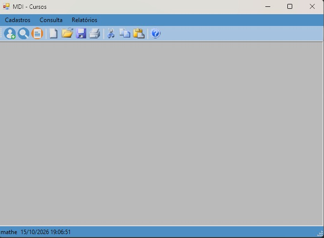
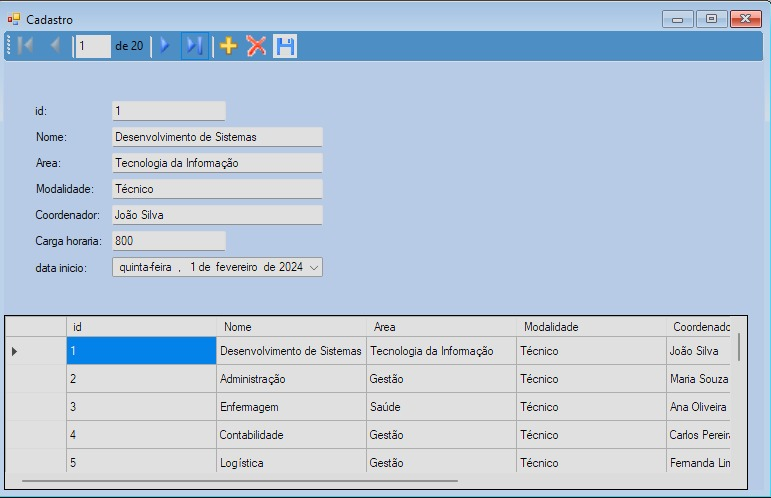
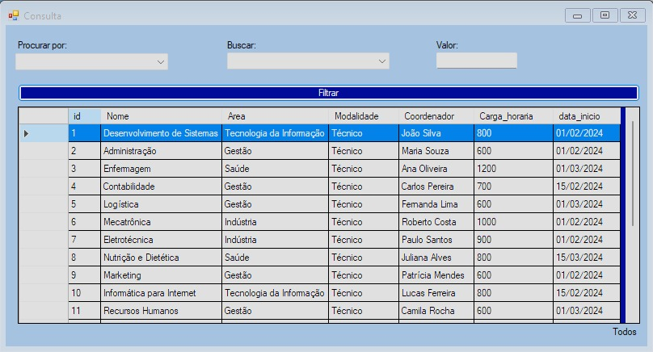
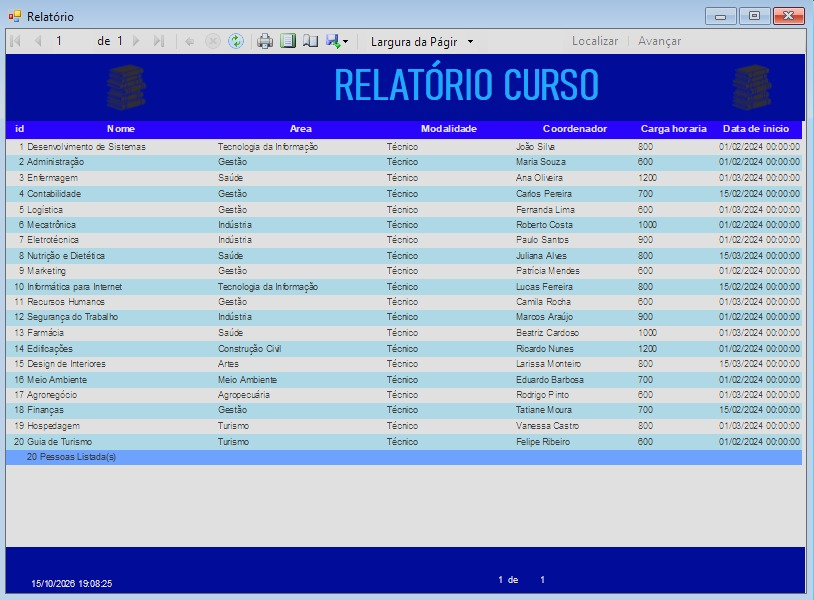

# Gestão de Cursos


Sistema desktop para cadastro, consulta e relatório de cursos, desenvolvido
em C# (WinForms) com SQL Server.



## 📚 Sobre o projeto
Projeto acadêmico desenvolvido em C#, com o objetivo de aprender a conexão de um projeto real com o banco de dados,
e aprender sobre filtros e consultas SQL. Realizei este projeto com o intuito de aprimorar meu conhecimento em C# e banco de dados,
além de ter pensado também em resolução de problemas, neste caso, procurar dados específicos em uma tabela SQL.

## ✨ Funcionalidades
- Cadastro de cursos (incluir, editar, excluir, navegar)
- Consulta com filtros por nome, área, modalidade, carga horária e data
- Relatório impresso/PDF com ReportViewer (RDLC)
- Interface MDI com menu, barra de ferramentas e barra de status

## 📸 Telas
| Menu principal | Cadastro |
|---|---|
|  |  |
| **Consulta** | **Relatório** |
|  |  |

## 📱 Tecnologias
- C# / .NET Framework 4.8 · Windows Forms
- SQL Server (Express) · ADO.NET com DataSet tipado
- Microsoft ReportViewer (RDLC)

## ▶️ Como executar
### Requisitos
- Windows 10/11
- Visual Studio 2022 (carga de trabalho ".NET desktop")
- SQL Server Express ou LocalDB

### Passos
1. Clone o repositório:
```bash
   git clone https://github.com/mths09/gestao-cursos-winforms.git
```
2. Crie o banco `db_251130` e a tabela `Curso` (veja *Banco de dados*).
3. Ajuste a connection string em `Projeto_FormularioCurso/App.config`.
4. Abra `sln_FormularioCurso.sln`, restaure os pacotes NuGet e execute (F5).

## 📦 Banco de dados
Tabela `Curso`:
| Coluna | Tipo | Observação |
|---|---|---|
| id | int | PK, identity |
| Nome | varchar(40) | |
| Area | varchar(40) | |
| Modalidade | varchar(40) | |
| Coordenador | varchar(40) | |
| Carga_horaria | (confirmar tipo) | |
| data_inicio | datetime | |

## 🗂️ Estrutura do projeto
```
Projeto_FormularioCurso/
├─ Formulários/   telas (menu MDI, cadastro, consulta, relatório)
├─ Data/          DataSet tipado e TableAdapters
├─ Relatório/     definição RDLC
└─ Properties/    configurações e recursos
```

## 🗺️ Roadmap
- [ ] Script SQL de criação do banco e dados de exemplo
- [ ] Validações de campos obrigatórios
- [ ] Tratamento de erros de banco
- [ ] Testes unitários da lógica de filtro
- [ ] Release com executável

## 📌 Aprendizados
- Binding de dados
- Como criar relatórios RDLC
- Como aplicar filtros em DataView
- Consultas SQL
- Comandos SQL
- Utilização de pacotes NuGet

## 👤Autor
**Matheus Ferenci Miranda leitão** · [LinkedIn]((https://www.linkedin.com/in/matheus-ferenci-miranda-leit%C3%A3o-a611b9374/)) · [GitHub]((https://github.com/mths09))

## 📄 Licença
Distribuído sob a licença MIT. Veja [LICENSE](LICENSE).
